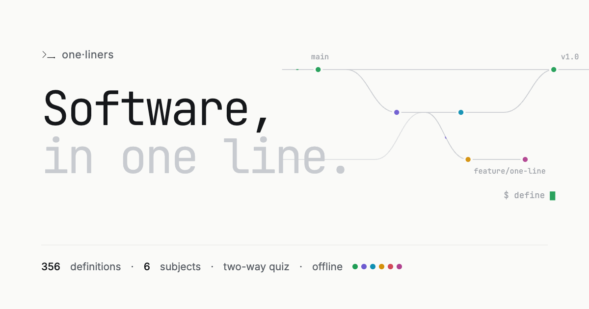
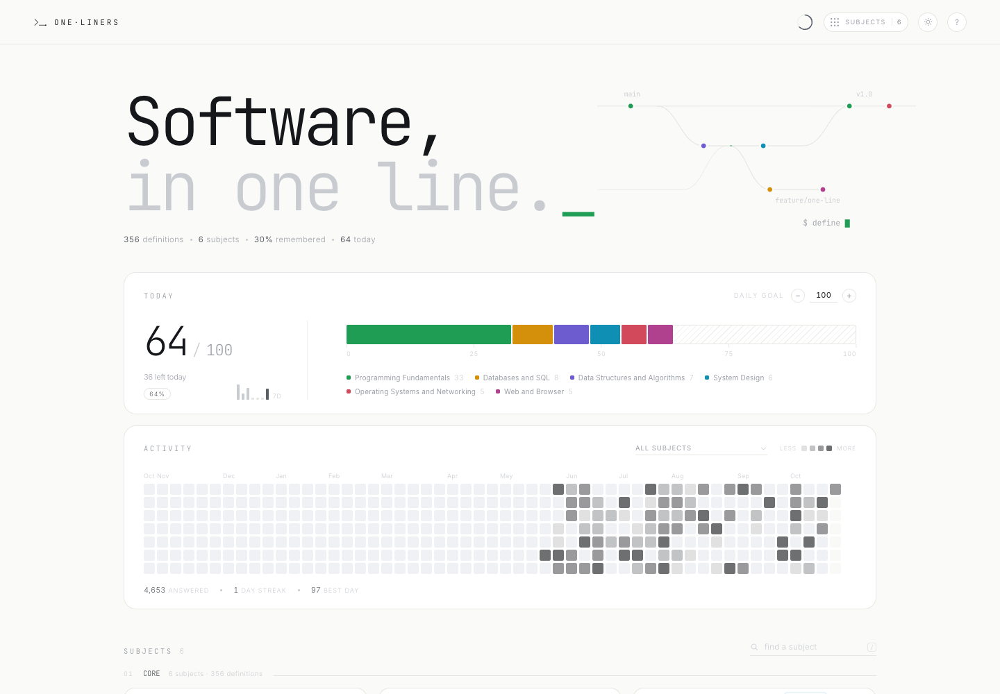
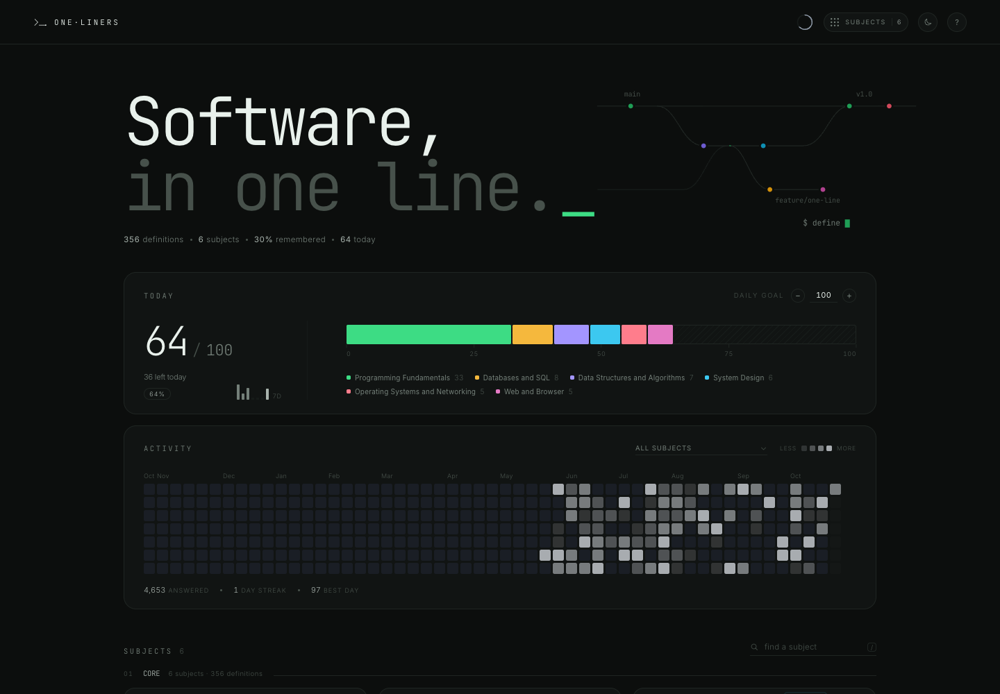
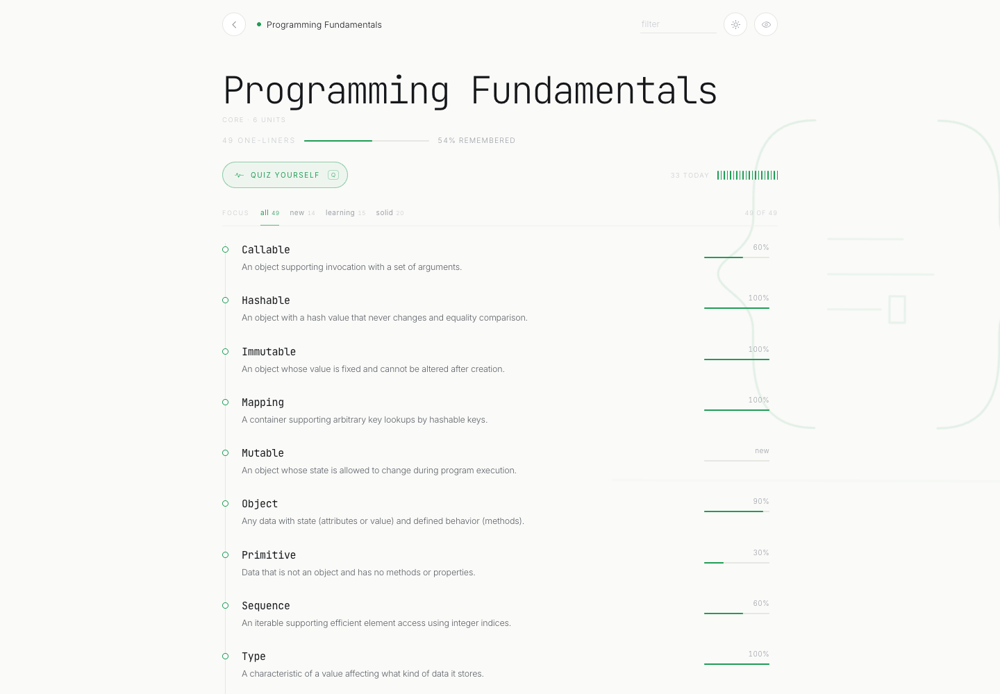
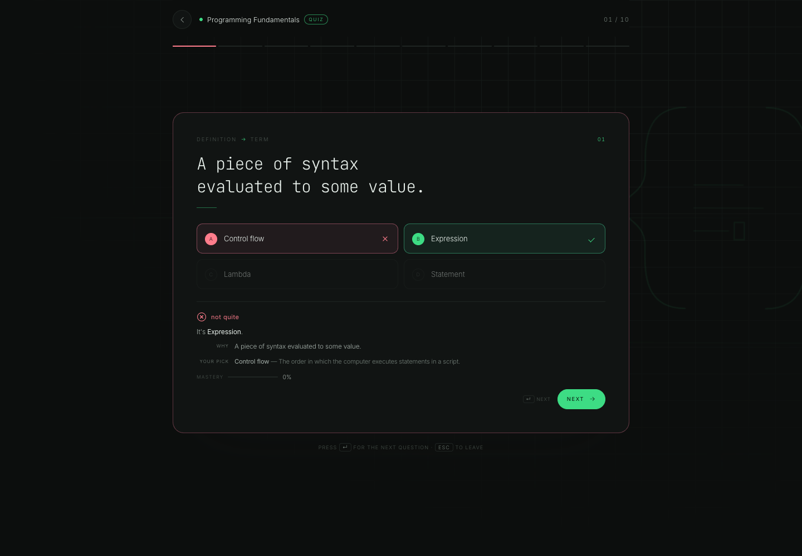
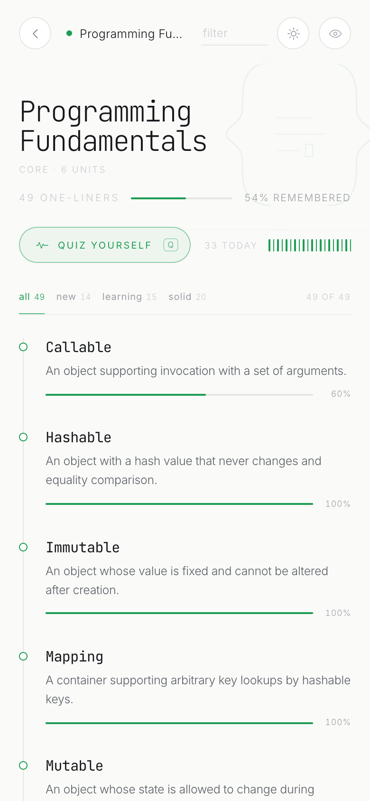

<div align="center">
  
</div>

<div align="center">

# one·liners · Software Interviews

**Software, in one line.**

A quiet glossary for software interviews: 356 definitions across 6 subjects — fundamentals, algorithms, system design, SQL, operating systems, networking and the web — with an adaptive two-way quiz and a memory of what you actually know.

<a href="https://abhinav-prabhakar.github.io/SoftwareInterviewDefinitions/">
  
</a>

<br /><br />


</div>

<p align="center"><sub>Screenshots use sample study data. The app itself starts clean, on your device.</sub></p>

---

## Why this exists

Interviews punish fuzzy vocabulary. You know what a *write-ahead log*, *idempotency key* or *amortized cost* is — until someone asks you to say it in one sentence. **one·liners** gives every term exactly one line, quizzes it both ways, and keeps the shaky ones coming back.

Printout paper, a monospace display face, terminal colours used sparingly. Each subject gets one hue, like syntax highlighting for a field. No accounts, no server, no noise.

> **Recognition is not recall.** Nodding at *consistent hashing* is not the same as producing it from its definition at a whiteboard. So the quiz asks both ways.

---

## Screenshots

<table>
  <tr>
    <td width="50%">
      
      <p align="center"><sub><strong>Light by default</strong> · today, activity, subject mastery</sub></p>
    </td>
    <td width="50%">
      
      <p align="center"><sub><strong>Dark when you choose it</strong> · remembered across visits</sub></p>
    </td>
  </tr>
</table>

<table>
  <tr>
    <td width="58%">
      
      <p align="center"><sub><strong>Every definition has a memory.</strong> Hover a row for its mastery and source.</sub></p>
    </td>
    <td width="42%">
      
      <p align="center"><sub><strong>Answers explain themselves.</strong> The definition, and what you picked.</sub></p>
    </td>
  </tr>
</table>

<div align="center">
  
  <p><sub><strong>320 → 1440px.</strong> The same quiet interface, not a crushed desktop.</sub></p>
</div>

---

## What's inside

**356 one-liners** across **6 subjects**, written for mid-level software engineer interview candidates.

- **Core** — Programming Fundamentals, Data Structures and Algorithms, System Design, Databases and SQL, Operating Systems and Networking, Web and Browser

| Subject | Definitions | Units |
| --- | ---: | --- |
| **Programming Fundamentals** | 49 | Types and values · Variables, scope and binding · Functions and closures · Control flow and recursion · Memory and references · Paradigms and abstraction |
| **Data Structures and Algorithms** | 68 | Complexity analysis · Arrays and linked lists · Stacks, queues and heaps · Trees and graphs · Hashing · Sorting and searching · Algorithm design techniques |
| **System Design** | 61 | Scalability and performance · Reliability and availability · Consistency and replication · Partitioning and load balancing · Caching and messaging · Operations and architecture |
| **Databases and SQL** | 65 | Relational model and schema · Keys and normalization · Querying and aggregation · Transactions and concurrency · Indexes and query execution · NoSQL and distributed storage |
| **Operating Systems and Networking** | 60 | Processes and threads · CPU scheduling · Memory management · Storage and file systems · Synchronization and deadlock · Network models and addressing · Transport and application protocols |
| **Web and Browser** | 53 | HTTP and transport · Browser architecture and rendering · The DOM and events · Security policies · Storage and state · Web APIs and performance |

Every definition is one sentence, 8–28 words, and carries a source locator. Hover a
definition's mastery rail to see where it came from. Coverage, gaps and assumptions are
documented in [`data/README.md`](data/README.md).

---

## Two directions of recall

Every round mixes both question types, balanced 5/5. You cannot coast on recognition.

| Prompt | You choose | What it trains |
| --- | --- | --- |
| `Idempotency` | one of four definitions | term → meaning |
| “Creating a new process by duplicating an existing one.” | one of four terms | meaning → term |

- **The term is never in the question.** When a definition has to mention its own term, the
  quiz blanks it out, so meaning → term tests meaning.
- **Wrong answers that look right.** Distractors come from each definition's curated
  look-alikes, then from similar wording in the same unit — never four random strangers.
- **Adaptive sampling.** The three weakest definitions are guaranteed a slot; the rest are
  weighted toward low mastery.
- **Keyboard complete.** <kbd>1</kbd>–<kbd>4</kbd> or <kbd>A</kbd>–<kbd>D</kbd> to choose,
  <kbd>Enter</kbd> for next, <kbd>Esc</kbd> to leave, <kbd>r</kbd> to repeat a round.

---

## A memory you can see

Mastery is one confidence score per definition, stored locally: **+30%** for a correct answer,
**−40%** for a miss. Four clean answers reach 100%.

| After | Score | Reads as |
| --- | --- | --- |
| no attempts | 0% | `new` |
| 1 correct | 30% | `learning` |
| 2 correct | 60% | `familiar` |
| 3 correct | 90% | `solid` |
| a miss | −40% | re-learn |

The subject page shows a 2px bar on every definition; cards show a bar profile of the whole
subject; the home page has a daily goal stack and a quiet, monochrome activity trail.

---

## Offline, installable, private

- **Full PWA** — manifest, service worker, maskable icons. Works offline after the first load.
  Install from the browser's own menu (Chrome: the install icon in the address bar; iOS Safari:
  **Share → Add to Home Screen**; macOS Safari: **File → Add to Dock**).
- **No accounts, no analytics, no server.** Progress lives in `localStorage` under
  `oneliners.software-interview-glossary.*` and never leaves the device.
- **Self-hosted type** — Inter, JetBrains Mono. No external font requests.
- **Light by default**, dark when you choose it, remembered before first paint.

---

## Sources

| Source | Publisher | License |
| --- | --- | --- |
| [Python Glossary](https://docs.python.org/3/glossary.html) | Python Software Foundation | PSF License |
| [MDN Web Docs Glossary](https://developer.mozilla.org/en-US/docs/Glossary) | MDN Web Docs (Mozilla) | CC BY-SA 2.5 |
| [OpenDSA: An Active eTextbook for Data Structures and Algorithms](https://opendsa-server.cs.vt.edu/) | OpenDSA Project (Virginia Tech) | MIT License |
| [Wikipedia articles on algorithms and data structures](https://en.wikipedia.org/wiki/Algorithm) | Wikimedia Foundation | CC BY-SA 4.0 |
| [AWS Glossary](https://docs.aws.amazon.com/general/latest/gr/glos-chap.html) | Amazon Web Services | unknown |
| [Site Reliability Engineering](https://sre.google/sre-book/table-of-contents/) | Google | CC BY-NC-ND 4.0 |
| [PostgreSQL Glossary (Appendix M)](https://www.postgresql.org/docs/current/glossary.html) | PostgreSQL Global Development Group | PostgreSQL License |
| [PostgreSQL Documentation](https://www.postgresql.org/docs/current/) | PostgreSQL Global Development Group | PostgreSQL License |
| [MongoDB Manual Glossary](https://www.mongodb.com/docs/manual/reference/glossary/) | MongoDB, Inc. | CC BY-NC-SA 3.0 Unported |
| [Operating Systems: Three Easy Pieces](https://pages.cs.wisc.edu/~remzi/OSTEP/) | Arpaci-Dusseau and Arpaci-Dusseau (University of Wisconsin-Madison) | unknown |
| [NIST Computer Security Resource Center Glossary](https://csrc.nist.gov/glossary) | National Institute of Standards and Technology (US government) | public domain (US government work) |
| [RFC 3022: Traditional IP Network Address Translator (Traditional NAT)](https://www.rfc-editor.org/rfc/rfc3022) | Internet Engineering Task Force | RFC license (2001 Internet Society, limited permissions) |
| [RFC 768: User Datagram Protocol](https://www.rfc-editor.org/rfc/rfc768) | Internet Engineering Task Force | unknown (no copyright statement on page) |

Definitions are paraphrased one-liners, not excerpts. Raw source material is not redistributed.

---

## Run it locally

```bash
# A server is required: the app fetches its data.
python3 -m http.server 8000
# → http://localhost:8000/
```

No build step, no dependencies. `index.html` is the whole app.

```text
.
├── index.html             # the entire app
├── manifest.webmanifest   # PWA manifest
├── sw.js                  # offline app shell + data cache
├── data/
│   ├── curriculum.json    # sections and subjects the app loads
│   ├── sources.json       # where every definition comes from
│   ├── collection.json    # scope, audience, assumptions
│   ├── README.md          # coverage report
│   └── subjects/*.json    # one file per subject
└── assets/                # icons, social card, screenshots, fonts
```

---

## The one·liners family

Same instrument, different vocabularies. Each has its own look, data and progress.

| Collection | Repository |
| --- | --- |
| [Electronics, in one line.](https://abhinav-prabhakar.github.io/ECEDefinitions/) | [`Abhinav-Prabhakar/ECEDefinitions`](https://github.com/Abhinav-Prabhakar/ECEDefinitions) |
| [Anatomy and physiology, in one line.](https://abhinav-prabhakar.github.io/AnatomyDefinitions/) | [`Abhinav-Prabhakar/AnatomyDefinitions`](https://github.com/Abhinav-Prabhakar/AnatomyDefinitions) |
| [Electricity, in one line.](https://abhinav-prabhakar.github.io/ElectricalCodeDefinitions/) | [`Abhinav-Prabhakar/ElectricalCodeDefinitions`](https://github.com/Abhinav-Prabhakar/ElectricalCodeDefinitions) |
| [HVAC, in one line.](https://abhinav-prabhakar.github.io/HVACDefinitions/) | [`Abhinav-Prabhakar/HVACDefinitions`](https://github.com/Abhinav-Prabhakar/HVACDefinitions) |
| [Medicine, in one line.](https://abhinav-prabhakar.github.io/MedicalTerminologyDefinitions/) | [`Abhinav-Prabhakar/MedicalTerminologyDefinitions`](https://github.com/Abhinav-Prabhakar/MedicalTerminologyDefinitions) |
| [Nursing, in one line.](https://abhinav-prabhakar.github.io/NursingDefinitions/) | [`Abhinav-Prabhakar/NursingDefinitions`](https://github.com/Abhinav-Prabhakar/NursingDefinitions) |
| [Pharmacology, in one line.](https://abhinav-prabhakar.github.io/PharmacologyDefinitions/) | [`Abhinav-Prabhakar/PharmacologyDefinitions`](https://github.com/Abhinav-Prabhakar/PharmacologyDefinitions) |
| [Plumbing, in one line.](https://abhinav-prabhakar.github.io/PlumbingDefinitions/) | [`Abhinav-Prabhakar/PlumbingDefinitions`](https://github.com/Abhinav-Prabhakar/PlumbingDefinitions) |
| **[Software, in one line.](https://abhinav-prabhakar.github.io/SoftwareInterviewDefinitions/)** | [`Abhinav-Prabhakar/SoftwareInterviewDefinitions`](https://github.com/Abhinav-Prabhakar/SoftwareInterviewDefinitions) |
| [The law, in one line.](https://abhinav-prabhakar.github.io/LegalDefinitions/) | [`Abhinav-Prabhakar/LegalDefinitions`](https://github.com/Abhinav-Prabhakar/LegalDefinitions) |

### Credits

Definitions are paraphrased from the openly licensed references listed above. Built on the [one·liners](https://github.com/Abhinav-Prabhakar/ECEDefinitions) engine. Fonts: Inter, JetBrains Mono (SIL Open Font License 1.1).

<div align="center">
  <sub>If this helps you land the offer, star the repo. It is a good nudge to keep the glossary growing.</sub>
</div>
